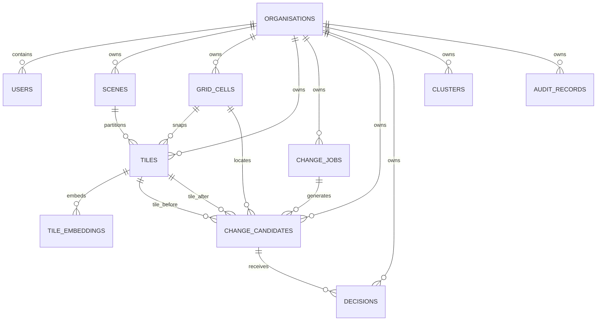

# DRISHTI — Database Schema & Data Models

## 1. Overview

The DRISHTI database is hosted on **PostgreSQL 16** with the following native extensions:
- `postgis`: Enables geospatial vector types, spatial predicates (`ST_Intersects`, `ST_Contains`), and GiST bounding-box indexes.
- `vector`: Enables fast approximate nearest neighbour (ANN) vector search via HNSW indexes.
- `pgcrypto`: Provides cryptographic generation of UUIDs and cryptographic hashing.

All entity primary keys use UUIDs or deterministic human-readable namespaced strings. All tenant-scoped entities implement `TenantMixin` (`organisation_id`), guaranteeing isolation across organisations.

---

## 2. Entity Relationship Diagram

---

## 3. Table Definitions

### `organisations`
| Column | Type | Constraints | Description |
|---|---|---|---|
| `id` | UUID | PK | Unique organisation identifier |
| `name` | VARCHAR(255) | NOT NULL | Display name (e.g. "MoD / DGIS") |
| `slug` | VARCHAR(100) | UNIQUE, NOT NULL | URL-safe identifier |
| `created_at` | TIMESTAMPTZ | NOT NULL | UTC creation timestamp |
| `updated_at` | TIMESTAMPTZ | NOT NULL | UTC modification timestamp |

### `users`
| Column | Type | Constraints | Description |
|---|---|---|---|
| `id` | UUID | PK | User identifier |
| `organisation_id` | UUID | FK -> organisations(id), NOT NULL | Tenant isolation foreign key |
| `email` | VARCHAR(255) | UNIQUE, NOT NULL | Analyst login email |
| `password_hash` | VARCHAR(255) | NOT NULL | Bcrypt password hash |
| `display_name` | VARCHAR(150) | NOT NULL | Analyst callsign / name |
| `role` | VARCHAR(50) | NOT NULL | "admin", "analyst", "viewer" |
| `is_active` | BOOLEAN | NOT NULL, DEFAULT true | Account status |

### `scenes`
| Column | Type | Constraints | Description |
|---|---|---|---|
| `id` | VARCHAR(100) | PK | Namespaced scene ID (e.g. "s2-2023-04-12") |
| `organisation_id` | UUID | FK -> organisations(id) | Tenant owner |
| `sensor` | VARCHAR(50) | NOT NULL, INDEX | "S2", "S1", "L8", "BHUVAN" |
| `product_level` | VARCHAR(50) | NOT NULL | e.g. "L2A" |
| `acquisition_datetime` | TIMESTAMPTZ | NOT NULL, INDEX | Sensing timestamp |
| `crs` | VARCHAR(50) | NOT NULL | Native coordinate reference system |
| `footprint` | GEOMETRY(POLYGON, 4326) | GIST INDEX | Boundary polygon |
| `bbox` | JSONB | NOT NULL | `[minLng, minLat, maxLng, maxLat]` |
| `cloud_percentage` | FLOAT | NOT NULL | Cloud cover (0..100) |
| `source_path` | VARCHAR(1024) | NOT NULL | Safe internal storage path |
| `checksum` | VARCHAR(64) | NOT NULL, INDEX | SHA-256 scene content hash |
| `licence` | VARCHAR(255) | NOT NULL | Provenance licence declaration |
| `ingestion_status` | VARCHAR(50) | NOT NULL | "processing", "done", "failed" |
| `ingested_at` | TIMESTAMPTZ | NOT NULL | Processing timestamp |

### `grid_cells`
| Column | Type | Constraints | Description |
|---|---|---|---|
| `id` | VARCHAR(100) | PK | Grid cell identifier |
| `organisation_id` | UUID | FK -> organisations(id) | Tenant owner |
| `grid_reference` | VARCHAR(100) | NOT NULL, INDEX | Snapped coordinate reference |
| `geometry` | GEOMETRY(POLYGON, 4326) | GIST INDEX | Cell bounding polygon |
| `bbox` | JSONB | NOT NULL | `[minLng, minLat, maxLng, maxLat]` |
| `crs` | VARCHAR(50) | NOT NULL | Fixed reference projection (EPSG:4326) |

### `tiles`
| Column | Type | Constraints | Description |
|---|---|---|---|
| `id` | VARCHAR(100) | PK | Tile identifier |
| `organisation_id` | UUID | FK -> organisations(id) | Tenant owner |
| `scene_id` | VARCHAR(100) | FK -> scenes(id) | Source parent scene |
| `grid_cell_id` | VARCHAR(100) | FK -> grid_cells(id) | Snapped analysis cell |
| `footprint` | GEOMETRY(POLYGON, 4326) | GIST INDEX | Tile spatial footprint |
| `datetime` | TIMESTAMPTZ | NOT NULL, INDEX | Acquisition timestamp |
| `sensor` | VARCHAR(50) | NOT NULL, INDEX | Sensor identifier |
| `gsd_m` | FLOAT | NOT NULL | Ground sample distance in metres (10.0) |
| `valid_fraction` | FLOAT | NOT NULL | Usable data fraction (0..1) |
| `cloud_fraction` | FLOAT | NOT NULL | Cloud cover fraction (0..1) |
| `thumbnail_path` | VARCHAR(1024) | NULL | Relative storage thumbnail path |
| `pixel_window` | JSONB | NULL | `{col_off, row_off, width, height}` |
| `embedding_status` | VARCHAR(50) | NOT NULL | "pending", "completed", "failed" |
| `cluster_id` | VARCHAR(100) | NULL, INDEX | Assigned HDBSCAN cluster |

### `tile_embeddings`
| Column | Type | Constraints | Description |
|---|---|---|---|
| `id` | UUID | PK | Embedding record identifier |
| `organisation_id` | UUID | FK -> organisations(id) | Tenant owner |
| `tile_id` | VARCHAR(100) | FK -> tiles(id) | Parent tile reference |
| `model_name` | VARCHAR(100) | NOT NULL, INDEX | "RemoteCLIP", "DINOv2" |
| `model_version` | VARCHAR(50) | NOT NULL | Checkpoint version |
| `dimension` | INTEGER | NOT NULL | Vector dimensionality (768) |
| `embedding` | VECTOR(768) | HNSW INDEX | pgvector cosine distance index |

### `audit_records`
| Column | Type | Constraints | Description |
|---|---|---|---|
| `id` | UUID | PK | Audit record identifier |
| `organisation_id` | UUID | FK -> organisations(id) | Tenant owner |
| `actor_id` | VARCHAR(100) | NOT NULL, INDEX | User or system actor |
| `actor_name` | VARCHAR(150) | NOT NULL | Analyst display name |
| `action` | VARCHAR(100) | NOT NULL, INDEX | Action verb (e.g. "candidate.decision") |
| `target_type` | VARCHAR(50) | NOT NULL | Target entity type ("candidate", "scene") |
| `target_id` | VARCHAR(100) | NOT NULL, INDEX | Target entity identifier |
| `payload` | JSONB | NOT NULL | Structured action context |
| `model_versions` | JSONB | NOT NULL | Snapshot of active model versions |
| `created_at` | TIMESTAMPTZ | NOT NULL, INDEX | UTC timestamp |
| `previous_hash` | VARCHAR(64) | NOT NULL | Hash of prior record |
| `record_hash` | VARCHAR(64) | UNIQUE, NOT NULL, INDEX | Chained SHA-256 hash |
